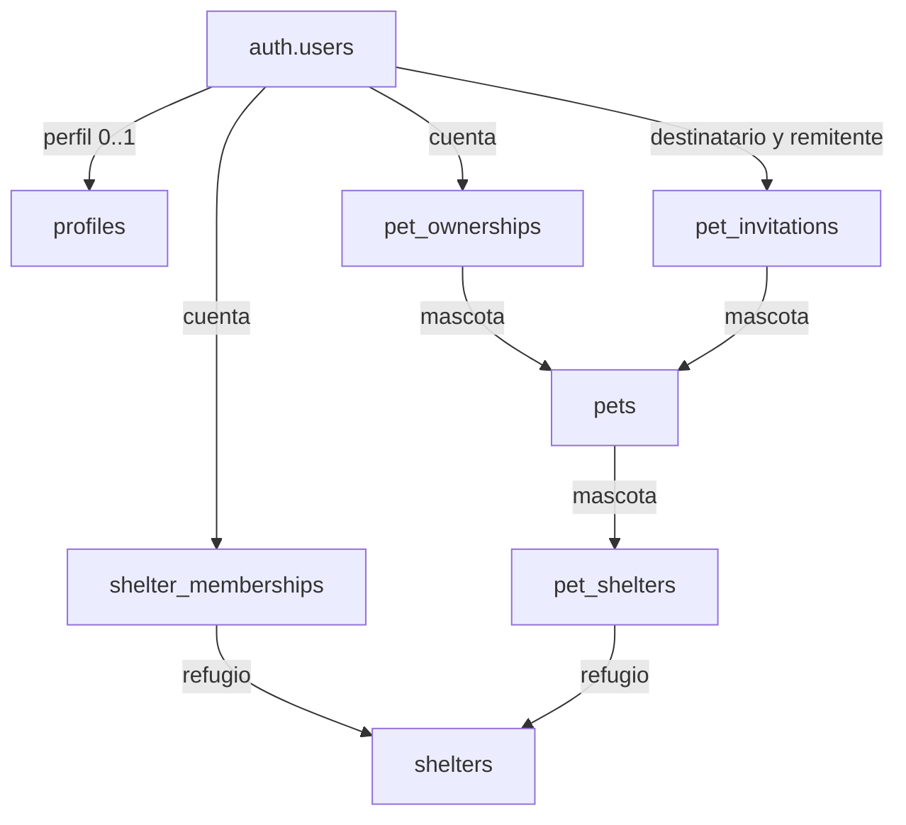

# PAWPASS — Estructura de la base de datos

**Proyecto:** pawpass · **Referencia:** `gjolkedvspnmueqatqyt`  
**Fecha de verificación:** 2026-10-19 17:50:00 CST
**Fuente:** catálogo real de PostgreSQL, políticas, privilegios, funciones, triggers, buckets e historial de migraciones de PAWPASS.

Este documento describe lo que está implementado, no una propuesta. El inventario
original fue de solo lectura y después se incorporaron las migraciones Q19 para la
ficha pública por QR.

## 1. Estado actual

| Elemento | Estado verificado |
|---|---|
| Motor | PostgreSQL 17 |
| Tablas propias | 18 en `public` y 2 en `private` |
| RLS | Activada en las 20 tablas |
| Migraciones registradas | 12 |
| Buckets de la aplicación | 2, ambos privados |
| Usuarios de Auth | 0 |
| Mascotas | 24 (21 del seed y 3 de demostración preexistentes) |
| Refugios | 3 (2 del seed y 1 de demostración preexistente) |
| Tutelas | 0 |
| Solicitudes de adopción | 0 |
| Metadata de documentos | 0 registros |
| Perfil anónimo por QR | Implementado mediante wrapper público acotado |

**`public` es el nombre de un schema de PostgreSQL; no significa que sus datos sean públicos.** Actualmente `anon` no tiene permisos de tablas ni de ejecución de las funciones propias en `public` y `private`. El acceso de `authenticated` depende además de RLS, rol de negocio y permisos por columna.

Las cuentas siguen gestionándose en `auth.users`, tabla interna de Supabase. No se duplica Auth en una tabla de usuarios propia. Los schemas internos de Supabase, como `auth` y `storage`, quedan fuera del inventario de las 20 tablas propias.

## 2. Organización por áreas

| Área | Tablas |
|---|---|
| Identidad y tutela | `profiles`, `pets`, `pet_ownerships`, `pet_invitations` |
| Contacto, consentimiento y pérdida | `pet_contacts`, `pet_privacy`, `pet_lost_alerts` |
| Salud | `pet_health`, `pet_veterinarians`, `pet_vaccines`, `pet_dewormings`, `pet_consultations` |
| Archivos | `pet_documents`, `consultation_documents`; buckets en Storage |
| Refugios | `shelters`, `shelter_memberships`, `pet_shelters` |
| Adopción | `adoption_requests`, `private.adoption_notes` |
| Auditoría | `private.audit_events` |

`public` contiene las entidades de negocio y las funciones RPC que puede invocar el cliente autenticado. `private` contiene tablas internas y funciones de autorización/operaciones privilegiadas. Algunos helpers de `private` tienen permiso EXECUTE para `authenticated`, porque participan en políticas y RPC; **private no equivale a inaccesible para todos los roles**. Los privilegios concretos se detallan más adelante.

## 3. Relaciones principales



Las flechas muestran relaciones, no un flujo de ejecución. Las FKs exactas y sus acciones de borrado aparecen en el diccionario de tablas.

| Relación | Cardinalidad | Regla |
|---|---|---|
| Cuenta → perfil | 1 → 0..1 | `profiles.id` es también FK a `auth.users.id` |
| Cuenta ↔ mascota | N:M | Mediante `pet_ownerships`; puede haber varios tutores activos |
| Mascota → contacto/privacidad/salud/veterinario | 1 → 0..1 cada una | `pet_id` es PK y FK; no todas las filas hijas se crean automáticamente |
| Mascota → alertas/documentos/vacunas/desparasitaciones/consultas | 1:N | Cada fila hija pertenece a una mascota |
| Consulta ↔ documento | N:M | Mediante `consultation_documents` |
| Cuenta ↔ refugio | N:M | Mediante `shelter_memberships` |
| Mascota ↔ refugio | N:M con historial | Mediante `pet_shelters` |
| Mascota → solicitudes | 1:N | Cada solicitud tiene una cuenta solicitante |
| Solicitud → notas internas | 1:N | Mediante `private.adoption_notes` |

## 4. Identificadores y tipos

- **UUID interno:** identifica filas y FKs. No debe utilizarse como prueba de propiedad.
- **`codigo_publico`:** identificador estable para URL/QR. Su formato es `PC-[A-Z0-9]+-[0-9]{3,}`.
- **`slug`:** alias opcional y único en mascotas/refugios, en minúsculas y con guiones.
- **`date`:** fecha de calendario; nacimiento, aplicación de vacuna, consulta o pérdida.
- **`timestamptz`:** instante con zona horaria; altas, modificaciones, aceptación y finalización.
- **`text[]`:** listas simples de atributos, como alergias o medicamentos. No sustituye relaciones con entidades.
- **`numeric`:** cantidades con precisión, como peso y recompensa.

`crear_mascota` genera un código aleatorio desde un UUID y añade `-001`. Los seeds tienen códigos DEMO identificables. El cliente autenticado no tiene UPDATE sobre `codigo_publico`, `slug`, `especie`, `estado` ni `verificado` en `pets`; el estado se cambia por RPC. La unicidad del código no lo convierte en secreto ni autoriza acceder a datos privados.

## 5. Tutores, administradores y cuentas

Hay que distinguir el rol PostgreSQL `authenticated` del rol de negocio `administrador` o `tutor`.

| Concepto | Significado |
|---|---|
| `anon` | Rol usado para solicitudes sin una sesión autenticada |
| `authenticated` | Rol de una sesión autenticada; no concede propiedad por sí mismo |
| Administrador de mascota | Tutela activa con `rol='administrador'`; gestiona consentimiento y expediente |
| Tutor | Tutela activa con `rol='tutor'`; lee su mascota y modifica campos básicos/estado autorizados |
| Administrador de refugio | Membresía con `rol='administrador'` en ese refugio |
| Miembro de refugio | Membresía del refugio; no obtiene expediente/contactos de mascotas automáticamente |
| Backend privilegiado | Puede realizar operaciones administrativas que los clientes no tienen permitidas |

`usuario_verificado` valida `auth.uid()`, existencia de cuenta, correo o teléfono confirmado, que la cuenta no sea anónima y que no tenga una suspensión vigente. `es_tutor` y `es_miembro_refugio` también comprueban estas condiciones al evaluar acceso por pertenencia. Las políticas de `profiles` se basan en el UUID propio; no todas las políticas usan el mismo requisito de verificación.

Una tutela está activa cuando `ended_at IS NULL`. El índice parcial `(pet_id,user_id)` impide repetir la misma relación activa, pero permite varios usuarios por mascota y relaciones históricas. **No hay un índice que garantice exactamente un administrador por mascota.** La creación por RPC asigna inicialmente uno; no debe confundirse esa regla del flujo con una restricción global del esquema.

Las invitaciones duran siete días por defecto. Solo el destinatario puede aceptarlas; se revisa que el remitente continúe siendo administrador. Las operaciones de tutela bloquean la fila de mascota para serializar cambios relacionados.

## 6. Privacidad y Q19

`pet_privacy` guarda `publicado`, `listar_catalogo` y consentimientos separados para nombre de contacto, teléfono, WhatsApp, secundario, email, zona, salud, veterinario, dirección veterinaria, emergencia y microchip. Todas las banderas nacen en `false`.

Además, vacunas, desparasitaciones, consultas y documentos tienen `visible_publico=false` por defecto. En la vista previa, publicar salud general no publica automáticamente todos sus registros: estos necesitan también su bandera individual. Los documentos se filtran por su consentimiento individual.

**Implementado:** `obtener_preview_perfil`, `listar_preview_catalogo` y `listar_preview_refugios`, que siguen restringidos a tutores/miembros autenticados y aplican los filtros de publicación pertinentes. `obtener_preview_perfil` requiere además que exista un administrador vigente y verificado. Un seed sin tutor no aparecerá en ese preview, aunque sea visible para el administrador de la base en el panel.

El QR anónimo se sirve por código aunque `publicado=false`; ese valor controla la
descubribilidad del perfil voluntario, no el acceso de quien ya tiene el QR. El wrapper
`public.obtener_ficha_publica(text)` devuelve identidad, foto principal, canal de contacto
elegido, zona aproximada y nota de cuidados. Durante una pérdida añade la alerta y un
resumen de vacunación. No devuelve el expediente ni documentos. La ruta entrega una URL
firmada de corta duración solo para la foto principal.

El directorio público de pérdidas usa `public.listar_mascotas_perdidas(integer, integer)`;
incluye únicamente mascotas con estado `perdido` y alerta vigente. La política anónima de
Storage se limita a la primera foto de cada mascota en `pawpass-fotos`; no habilita el
bucket `pawpass-documentos` ni fotos adicionales.

## 7. Estado de mascota y emergencia

Los estados admitidos son `en_casa`, `perdido`, `en_adopcion`, `adoptado`, `rescatado` y `fallecido`, mediante CHECK; no se creó un enum PostgreSQL.

`cambiar_estado_mascota` valida administración, bloquea la mascota, cierra la alerta anterior y cambia el estado en una transacción. Si el destino es `perdido`, exige fecha no futura, zona, canal QR con dato y foto subida antes de crear la alerta. El índice parcial de alertas impide dos pérdidas activas de la misma mascota.

El trigger impide salir de `fallecido`; la RPC cierra la alerta al pasar a ese estado. La congruencia entre estado y alerta es una regla del flujo RPC, no una FK o CHECK que cubra todas las posibles escrituras de un backend privilegiado. Los seeds de pérdida se cargaron con ambos datos coherentes.

El QR muestra la nota de cuidados redactada por el dueño. La alerta y el resumen de vacunas solo aparecen en estado `perdido`; nunca se exponen datos médicos detallados por ese estado. No hay una segunda bandera `perdido` almacenada en `pets`: la vista previa la deriva del estado.

## 8. Salud y documentos

`pet_health` conserva información general; las aplicaciones y consultas se normalizan en sus propias tablas. `pet_veterinarians` conserva datos del profesional, sin representarlo todavía como usuario con permisos clínicos.

Las próximas fechas deben ser posteriores o iguales a la fecha aplicada. Triggers rechazan aplicación/consulta futura. Las fechas de nacimiento futuras también se rechazan. Un valor NULL indica información no registrada: no demuestra ausencia de una condición médica.

No se almacena una columna `estatus` de vacuna. La vista previa calcula una etiqueta calendárica: vencida si la próxima dosis ya pasó, próxima dosis si corresponde al día de México, al día en el resto de casos. **Es una etiqueta técnica de la proyección, no una validación clínica; una próxima dosis NULL necesita tratamiento explícito en el adapter para no asumir que el expediente está completo.**

Las FKs compuestas `(pet_id,documento_id)` y las de `consultation_documents` impiden adjuntar documentos de otra mascota. No hay correlaciones por igualdad de URL.

La identidad del documento y su ruta se asignan en el servidor. El trigger no permite cambiar `id`, `pet_id`, `bucket_id` ni `object_path` de un documento existente. El path tiene forma `<UUID-del-documento>/archivo`; `mime_type` indica el formato, no la extensión.

## 9. Storage

| Bucket | Público | Tamaño máximo | MIME admitidos |
|---|---|---|---|
| `pawpass-fotos` | No | 5 MiB | JPEG, PNG, WebP |
| `pawpass-documentos` | No | 10 MiB | PDF, JPEG, PNG, WebP |

El registro de `pet_documents` debe existir antes de subir el archivo. La lectura requiere tutela vigente; insertar, reemplazar y borrar requieren administración de la mascota. Las políticas aplican al bucket y path registrados, y los helpers verifican la pertenencia actual.

El tamaño en metadata `tamano_bytes` es distinto del límite del bucket; esta tabla no demuestra por sí sola que el archivo exista o que su tamaño declarado coincida con bytes subidos. Los seeds no crearon archivos ni metadata ficticia de archivos.

Las URLs firmadas son temporales y no se guardan como fuente de verdad. Una URL ya firmada puede seguir funcionando hasta que expire, aunque se revoque tutela o consentimiento. La aplicación debe usar caducidad corta y evitar cachear datos privados.

Eliminar metadata no elimina automáticamente los bytes. La aplicación debe coordinar el borrado mediante Storage API; un archivo sin metadata queda fuera de las políticas ordinarias, pero requiere limpieza física.

## 10. Refugios y adopciones

Crear un refugio por RPC crea también la membresía administradora de la cuenta que lo solicita. No hay permisos ordinarios de escritura directa en `shelter_memberships`, ni RPC actual para invitar nuevos miembros de refugio. Esa gestión sigue siendo administrativa.

Crear un vínculo mascota–refugio exige administrar ambos lados. Los miembros pueden consultar el vínculo; eso no les concede acceso a `pets`, salud o contacto sin tutela propia.

Las solicitudes de adopción requieren cuenta verificada. La mascota debe estar publicada, en adopción, tener una tutela administradora activa y no tener alerta activa. El solicitante no puede ser tutor de esa mascota. Se limita a diez solicitudes por cuenta en una ventana móvil de 24 horas, usando un bloqueo de transacción por solicitante; no se resetea a medianoche.

| Origen | Destinos permitidos por revisión |
|---|---|
| `enviada` | `en_revision`, `rechazada` |
| `en_revision` | `aprobada`, `rechazada` |
| `aprobada` | `completada`, `rechazada` |
| `enviada`, `en_revision`, `aprobada` | El propio solicitante puede cancelar |

Al completar, el adoptante debe haber aceptado antes una invitación de tutor. La transacción finaliza tutelas de los demás usuarios, convierte al adoptante en administrador, revoca invitaciones pendientes, termina los vínculos de cuidado, cambia la mascota a `adoptado`, rechaza solicitudes competidoras abiertas y despublica el perfil para renovar consentimiento.

El aspirante y el administrador de la mascota pueden leer la solicitud. Nombre, teléfono, email y motivo no son datos de catálogo. `private.adoption_notes` separa posibles notas internas, pero todavía no tiene un flujo de escritura/consulta para usuarios.

## 11. Matriz de acceso ordinario

La siguiente tabla resume GRANT + RLS. No describe el acceso de un backend que pueda saltarse RLS.

| Tabla/área | Lectura autenticada | Escritura autenticada |
|---|---|---|
| `profiles` | Perfil propio | Inserta id/nombre propios; actualiza solo nombre |
| `pets` | Tutores activos verificados | Tutor actualiza campos básicos; creación/estado por RPC |
| `pet_ownerships` | Tutores de la mascota | Solo RPC autorizadas |
| `pet_invitations` | Destinatario o administrador de mascota | Solo RPC autorizadas |
| `pet_contacts`, `pet_privacy` | Tutores | Administrador; columnas permitidas |
| `pet_lost_alerts` | Tutores | Mediante RPC de estado |
| Salud, documentos y enlaces de consulta | Tutores | Administrador de mascota; RLS en INSERT/UPDATE/DELETE |
| `shelters` | Miembros verificados | Administrador actualiza campos; creación por RPC |
| `shelter_memberships` | Miembros del refugio | Backend autorizado |
| `pet_shelters` | Tutor o miembro del refugio | Administrador de ambos lados; INSERT pet/refugio, UPDATE fin |
| `adoption_requests` | Solicitante o administrador de mascota | RPC con validación de transición |
| Tablas `private` | Sin permisos ordinarios de tabla | Auditoría por triggers; notas reservadas |
| Storage | Tutores | Administrador de mascota |

Los permisos por columna impiden modificar desde el cliente identificadores o verificación reservados. RLS comprueba la fila de origen con USING y, donde corresponde, la fila resultante con WITH CHECK.

`FORCE ROW LEVEL SECURITY` no está activado en estas tablas. RLS protege roles ordinarios, pero roles con BYPASSRLS y ciertas funciones SECURITY DEFINER siguen siendo una frontera privilegiada. No usar claves secretas/service-role en el cliente.

## 12. RPC disponibles

Las RPC privadas de cuenta requieren `authenticated`. Los dos RPC públicos de lectura tienen proyección acotada y permiten `anon`; la mutación de estado sigue requiriendo `authenticated` y administración.

| RPC y parámetros | Retorno | Función |
|---|---|---|
| `aceptar_invitacion(p_invitacion uuid)` | `void` | Acepta una invitación propia vigente y crea tutela. |
| `cambiar_estado_mascota(p_pet uuid, p_estado text, p_fecha date, p_zona text, p_mensaje text, p_recompensa numeric)` | `void` | Solo administración; perder exige canal de contacto y foto válida. |
| `crear_mascota(p_nombre text, p_especie text, p_nacimiento date, p_medio_contacto text, p_valor_contacto text, p_foto_nombre text, p_foto_mime text, p_foto_tamano bigint)` | `jsonb` | Requiere cuenta verificada, fecha no futura, un teléfono/WhatsApp/correo válido y foto privada JPEG/PNG/WebP de hasta 5 MiB. Crea mascota, tutela administradora, contacto elegido, privacidad cerrada y metadata de foto; devuelve UUID de mascota/documento, ruta privada y código público. Los bytes se suben después con la sesión del tutor y RLS de Storage. |
| `crear_refugio(p_nombre text)` | `uuid` | Crea refugio y primera membresía administradora. |
| `invitar_tutor(p_pet uuid, p_usuario uuid)` | `uuid` | Invita a una cuenta existente; devuelve UUID de invitación. |
| `listar_preview_catalogo(p_limite integer, p_offset integer)` | `jsonb` | Devuelve catálogo paginado de las mascotas del tutor que cumplen publicación/disponibilidad. |
| `listar_preview_refugios(p_limite integer, p_offset integer)` | `jsonb` | Devuelve refugios publicados del miembro, con contactos filtrados. |
| `listar_mascotas_perdidas(p_limite integer, p_offset integer)` | `jsonb` | Público sin sesión; solo alertas activas y campos de rescate permitidos. |
| `obtener_ficha_publica(p_codigo text)` | `jsonb` | Público sin sesión; QR básico aunque el perfil voluntario no esté publicado. |
| `obtener_preview_perfil(p_identificador text)` | `jsonb` | Devuelve JSON filtrado por consentimiento, para tutor de perfil publicado. |
| `revisar_adopcion(p_solicitud uuid, p_estado text)` | `void` | Revisa, cancela o completa solicitud según rol/transición. |
| `revocar_tutor(p_pet uuid, p_usuario uuid)` | `void` | Finaliza tutela de un tutor; no permite revocar administración sin transferirla. |
| `solicitar_adopcion(p_codigo text, p_nombre text, p_telefono text, p_email text, p_motivo text)` | `uuid` | Envía solicitud privada para una mascota disponible; devuelve UUID. |
| `transferir_administracion(p_pet uuid, p_usuario uuid)` | `void` | Transfiere a otro tutor activo; revoca invitaciones pendientes. |

Las implementaciones internas SECURITY DEFINER están en `private` y fijan `search_path=''`. Esta elevación se usa para operaciones atómicas que no se permiten directamente al cliente; no elimina la necesidad de revisar la autorización en cada función.

El JSON de preview incluye metadata bucket/path de documentos, no URLs finales ni `fotoPerfilUrl`. La aplicación debe resolver URLs, adaptar valores NULL y mapear el resultado al contrato de presentación antes de usarlo en el sitio.

## 13. Auditoría, historial y borrado

Los triggers de auditoría registran inserciones, cambios y borrados en las tablas donde están instalados. La auditoría no cubre por sí sola lecturas, llamadas fallidas, accesos HTTP de Storage o bytes de archivos. La lista real de triggers figura en el apéndice.

`audit_events.actor` guarda el UUID del actor, sin FK a Auth. Puede ser NULL en operaciones administrativas sin claims; los seeds tienen esa situación. No es una tabla de historial completo antes/después ni un historial tipado de estados: guarda qué registro cambió, no todos sus valores.

Tutelas, pérdida y cuidado de refugios usan finalización temporal. No existe una columna global `deleted_at` para soft delete de mascotas, solicitudes o documentos. Varias FKs usan ON DELETE CASCADE; otras referencias de documentos usan NO ACTION y bloquean borrar un documento vinculado hasta retirar sus enlaces.

La eliminación de una cuenta puede eliminar en cascada perfiles, tutelas, invitaciones, membresías y solicitudes, sin borrar la mascota. Debe diseñarse un flujo administrativo de transferencia/retención antes de eliminar cuentas; actualmente puede dejar una mascota sin administrador. Esta documentación no afirma que ese proceso ya esté implementado.

## 14. Seeds actuales

| Query | Código | Nombre | Estado | Datos relacionados |
|---|---|---|---|---|
| Q22 | PC-DEMOALFA-001 | Demo Alfa | en_casa | Contacto vacío, privacidad, salud, vacuna y desparasitación ficticias |
| Q23 | PC-DEMOBETA-002 | Demo Beta | perdido | Contacto vacío, privacidad, salud, consulta ficticia y una alerta activa |
| Q24 | PC-DEMOGAMMA-003 | Demo Gamma | en_adopcion | Contacto vacío, privacidad, salud, consulta ficticia y vínculo al refugio demo |

Los tres seeds son privados, no están en catálogo y carecen de tutor. El refugio DEMO carece de miembros y publicación. No se inventaron cuentas de Auth, teléfonos ni correos de personas.

Las queries de seed son idempotentes para sus registros: al repetirse no crean duplicados ni sobrescriben datos; si el código corresponde a otro registro, abortan. Los seeds no son un ejemplo de alta de producción: se crearon administrativamente sin cuentas y no pueden probar aún el dashboard del tutor.

## 15. Queries y migraciones

La numeración identifica scripts y categorías; no todos los scripts son migraciones. Las verificaciones y seeds no crean entradas de esquema en el historial.

| Categoría | Queries | Estado |
|---|---|---|
| 01 — Núcleo | Q01–Q05 | Núcleo preexistente y verificaciones |
| 02 — Seguridad/perfiles | Q06–Q09 | Auditoría, acceso propio y autorización interna |
| 03 — Mascotas | Q10–Q11, Q14 | Modelo, operaciones y preview privado aplicados |
| 04 — Salud | Q12 | Aplicada |
| 05 — Refugios/adopciones | Q13 | Aplicada |
| 06 — Storage | Q15 | Aplicada |
| 07 — Pruebas | Q16, Q20 | Pruebas con rollback ejecutadas durante implementación |
| 02 — Integridad/concurrencia | Q17–Q18 | Aplicadas |
| 03 — Acceso público | Q19 | Wrapper público de ficha QR aplicado y verificado |
| 07 — Inventario | Q21 | Verificación |
| 08 — Seeds | Q22–Q24 | Tres conjuntos cargados |
| 08 — Verificar seeds | Q25 | Verificada privacidad y ausencia de duplicados |

### Historial real de migraciones

| Versión | Nombre |
|---|---|
| `20261012183223` | `q07_seguridad_perfiles_acceso_propio` |
| `20261012183849` | `q09_autorizacion_interna_indices` |
| `20261012183914` | `q10_mascotas_privacidad_contactos` |
| `20261012184011` | `q11_creacion_tutores_estados` |
| `20261012184104` | `q12_salud_documentos_normalizados` |
| `20261012184235` | `q13_refugios_adopciones_privadas` |
| `20261012184358` | `q14_preview_privado_consentimiento` |
| `20261012184438` | `q15_storage_fotos_documentos_privados` |
| `20261012190318` | `q17_integridad_indices_privilegios` |
| `20261012190435` | `q18_limite_solicitudes_concurrencia` |
| `20261019223611` | `q19_ficha_publica_qr` |
| `20261019240000` | `q19_public_wrapper_definer` |

Las queries no están guardadas automáticamente como pestañas/carpetas del SQL Editor: se entregaron en archivos por categoría. No reejecutar migraciones ya aplicadas en PAWPASS.

## 16. Verificación y límites

Las pruebas anteriores Q16 comprobaron aislamiento entre tres cuentas de prueba, invitaciones, revocación, consentimiento, referencias entre mascotas y estado terminal. Q20 comprobó privacidad de solicitudes y transferencia con aceptación previa. Usaron roles PostgreSQL y claims simulados; las cuentas/filas de prueba se revirtieron. Los seeds Q22–Q24, en cambio, permanecen.

Este documento se contrastó con el catálogo actual. No se ejecutaron nuevas pruebas de escritura para elaborarlo. Los resultados anteriores no equivalen a pruebas HTTP completas, a pruebas del frontend o a una garantía absoluta de seguridad.

### Pendientes de integración

1. Crear cuentas reales y asignar administrativamente tutor/miembros a los demos si se quieren usar en la aplicación.
2. Completar el adapter autenticado del catálogo; las rutas de catálogo y adopción todavía usan datos estáticos.
3. Resolver fotos/documentos a URLs firmadas y coordinar borrado de bytes/metadata.
4. Diseñar entrega/descubrimiento de destinatarios de invitaciones sin listar todas las cuentas.
5. Implementar gestión de miembros de refugio y notas internas si el producto la necesita.
6. Diseñar eliminación de cuentas, transferencia, retención de datos y limpieza de archivos huérfanos.
7. Mantener la estrategia offline sin cachear automáticamente expedientes o contactos privados.

No hay todavía una entidad de cuenta veterinaria, un catálogo normalizado de medicamentos ni una tabla de carnet físico. El carnet, la edad, el catálogo y el expediente exportable deben derivarse de datos existentes.

---

## Apéndice A. Diccionario completo de tablas

El diccionario se generó a partir del catálogo de PAWPASS. NULL significa que la columna admite ausencia de dato. Los valores predeterminados pueden ser complementados por triggers: por ejemplo, la identidad/path de documentos y los timestamps se fijan en el servidor.

Las restricciones muestran la definición real. En una FK, si no aparece ON DELETE explícito, aplica NO ACTION. El nombre de una restricción no sustituye su definición.

### public.profiles

Perfil mínimo de una cuenta: nombre del usuario. La identidad y el inicio de sesión pertenecen a Supabase Auth.

| Columna | Tipo | NULL | Predeterminado |
|---|---|---|---|
| `id` | `uuid` | No | — |
| `full_name` | `text` | Sí | — |
| `created_at` | `timestamp with time zone` | No | `now()` |
| `updated_at` | `timestamp with time zone` | No | `now()` |

**Restricciones**

- `profiles_full_name_length`: `CHECK (((full_name IS NULL) OR ((char_length(btrim(full_name)) >= 1) AND (char_length(btrim(full_name)) <= 120))))`.
- `profiles_id_fkey`: `FOREIGN KEY (id) REFERENCES auth.users(id) ON DELETE CASCADE`.
- `profiles_pkey`: `PRIMARY KEY (id)`.

**Índices**

```sql
CREATE UNIQUE INDEX profiles_pkey ON public.profiles USING btree (id);
```

### public.pets

Entidad central de mascota. Identidad interna, código QR, características físicas, estado y verificación.

| Columna | Tipo | NULL | Predeterminado |
|---|---|---|---|
| `id` | `uuid` | No | `gen_random_uuid()` |
| `codigo_publico` | `text` | No | — |
| `nombre` | `text` | No | — |
| `especie` | `text` | No | — |
| `estado` | `text` | No | `'en_casa'::text` |
| `fecha_nacimiento` | `date` | Sí | — |
| `created_at` | `timestamp with time zone` | No | `now()` |
| `updated_at` | `timestamp with time zone` | No | `now()` |
| `slug` | `text` | Sí | — |
| `raza` | `text` | Sí | — |
| `genero` | `text` | Sí | — |
| `talla` | `text` | Sí | — |
| `color` | `text` | Sí | — |
| `peso_kg` | `numeric(7,3)` | Sí | — |
| `esterilizado` | `boolean` | Sí | — |
| `rasgos_distintivos` | `text[]` | No | `'{}'::text[]` |
| `microchip` | `text` | Sí | — |
| `notas_identificacion` | `text` | Sí | — |
| `verificado` | `boolean` | No | `false` |

**Restricciones**

- `pets_codigo_publico_format`: `CHECK ((codigo_publico ~ '^PC-[A-Z0-9]+-[0-9]{3,}$'::text))`.
- `pets_codigo_publico_key`: `UNIQUE (codigo_publico)`.
- `pets_color_check`: `CHECK ((char_length(color) <= 120))`.
- `pets_especie_check`: `CHECK ((especie = ANY (ARRAY['perro'::text, 'gato'::text])))`.
- `pets_estado_check`: `CHECK ((estado = ANY (ARRAY['en_casa'::text, 'perdido'::text, 'en_adopcion'::text, 'adoptado'::text, 'rescatado'::text, 'fallecido'::text])))`.
- `pets_genero_check`: `CHECK ((genero = ANY (ARRAY['macho'::text, 'hembra'::text])))`.
- `pets_microchip_check`: `CHECK (((char_length(microchip) >= 1) AND (char_length(microchip) <= 50)))`.
- `pets_microchip_key`: `UNIQUE (microchip)`.
- `pets_nombre_length`: `CHECK (((char_length(btrim(nombre)) >= 1) AND (char_length(btrim(nombre)) <= 120)))`.
- `pets_notas_identificacion_check`: `CHECK ((char_length(notas_identificacion) <= 2000))`.
- `pets_peso_kg_check`: `CHECK (((peso_kg > (0)::numeric) AND (peso_kg <= (500)::numeric)))`.
- `pets_pkey`: `PRIMARY KEY (id)`.
- `pets_rasgos_distintivos_check`: `CHECK (((cardinality(rasgos_distintivos) <= 30) AND (octet_length((rasgos_distintivos)::text) <= 8000)))`.
- `pets_raza_check`: `CHECK ((char_length(raza) <= 120))`.
- `pets_slug_check`: `CHECK (((slug ~ '^[a-z0-9]+(-[a-z0-9]+)*$'::text) AND (char_length(slug) <= 80)))`.
- `pets_slug_key`: `UNIQUE (slug)`.
- `pets_talla_check`: `CHECK ((talla = ANY (ARRAY['miniatura'::text, 'pequeno'::text, 'mediano'::text, 'grande'::text])))`.

**Índices**

```sql
CREATE UNIQUE INDEX pets_codigo_publico_key ON public.pets USING btree (codigo_publico);
CREATE UNIQUE INDEX pets_microchip_key ON public.pets USING btree (microchip);
CREATE UNIQUE INDEX pets_pkey ON public.pets USING btree (id);
CREATE UNIQUE INDEX pets_slug_key ON public.pets USING btree (slug);
```

### public.pet_ownerships

Relación entre cuenta y mascota, con rol y periodo de vigencia. Conserva tutelas finalizadas.

| Columna | Tipo | NULL | Predeterminado |
|---|---|---|---|
| `id` | `uuid` | No | `gen_random_uuid()` |
| `pet_id` | `uuid` | No | — |
| `user_id` | `uuid` | No | — |
| `started_at` | `timestamp with time zone` | No | `now()` |
| `ended_at` | `timestamp with time zone` | Sí | — |
| `created_at` | `timestamp with time zone` | No | `now()` |
| `rol` | `text` | No | `'tutor'::text` |

**Restricciones**

- `pet_ownerships_dates_check`: `CHECK (((ended_at IS NULL) OR (ended_at >= started_at)))`.
- `pet_ownerships_pet_id_fkey`: `FOREIGN KEY (pet_id) REFERENCES pets(id) ON DELETE CASCADE`.
- `pet_ownerships_pkey`: `PRIMARY KEY (id)`.
- `pet_ownerships_rol_check`: `CHECK ((rol = ANY (ARRAY['administrador'::text, 'tutor'::text])))`.
- `pet_ownerships_user_id_fkey`: `FOREIGN KEY (user_id) REFERENCES auth.users(id) ON DELETE CASCADE`.

**Índices**

```sql
CREATE UNIQUE INDEX pet_ownerships_active_unique ON public.pet_ownerships USING btree (pet_id, user_id) WHERE (ended_at IS NULL);
CREATE INDEX pet_ownerships_pet_idx ON public.pet_ownerships USING btree (pet_id);
CREATE UNIQUE INDEX pet_ownerships_pkey ON public.pet_ownerships USING btree (id);
CREATE INDEX pet_ownerships_user_active_idx ON public.pet_ownerships USING btree (user_id, pet_id) WHERE (ended_at IS NULL);
CREATE INDEX pet_ownerships_user_idx ON public.pet_ownerships USING btree (user_id);
```

### public.pet_invitations

Invitación dirigida a una cuenta existente para convertirse en tutor. Incluye caducidad, aceptación y revocación.

| Columna | Tipo | NULL | Predeterminado |
|---|---|---|---|
| `id` | `uuid` | No | `gen_random_uuid()` |
| `pet_id` | `uuid` | No | — |
| `invited_user_id` | `uuid` | No | — |
| `invited_by` | `uuid` | No | — |
| `expires_at` | `timestamp with time zone` | No | `(now() + '7 days'::interval)` |
| `accepted_at` | `timestamp with time zone` | Sí | — |
| `revoked_at` | `timestamp with time zone` | Sí | — |
| `created_at` | `timestamp with time zone` | No | `now()` |

**Restricciones**

- `pet_invitations_check`: `CHECK ((invited_user_id <> invited_by))`.
- `pet_invitations_check1`: `CHECK ((expires_at > created_at))`.
- `pet_invitations_invited_by_fkey`: `FOREIGN KEY (invited_by) REFERENCES auth.users(id) ON DELETE CASCADE`.
- `pet_invitations_invited_user_id_fkey`: `FOREIGN KEY (invited_user_id) REFERENCES auth.users(id) ON DELETE CASCADE`.
- `pet_invitations_pet_id_fkey`: `FOREIGN KEY (pet_id) REFERENCES pets(id) ON DELETE CASCADE`.
- `pet_invitations_pkey`: `PRIMARY KEY (id)`.

**Índices**

```sql
CREATE INDEX pet_invitations_pet_idx ON public.pet_invitations USING btree (pet_id);
CREATE UNIQUE INDEX pet_invitations_pkey ON public.pet_invitations USING btree (id);
CREATE INDEX pet_invitations_sender_idx ON public.pet_invitations USING btree (invited_by);
CREATE INDEX pet_invitations_target_idx ON public.pet_invitations USING btree (invited_user_id);
```

### public.pet_contacts

Contacto y zonas de la mascota, separados de los atributos de pets. Sus campos no son públicos por existir.

| Columna | Tipo | NULL | Predeterminado |
|---|---|---|---|
| `pet_id` | `uuid` | No | — |
| `medio_contacto_qr` | `text` | Sí | — |
| `nombre_publico` | `text` | Sí | — |
| `telefono_principal` | `text` | Sí | — |
| `whatsapp` | `text` | Sí | — |
| `telefono_secundario` | `text` | Sí | — |
| `email` | `text` | Sí | — |
| `zona_segura` | `text` | Sí | — |
| `zona_habitual` | `text` | Sí | — |
| `mensaje_whatsapp` | `text` | Sí | — |
| `created_at` | `timestamp with time zone` | No | `now()` |
| `updated_at` | `timestamp with time zone` | No | `now()` |

**Restricciones**

- `pet_contacts_email_check`: `CHECK (((char_length(email) <= 254) AND (email ~ '^[^[:space:]@]+@[^[:space:]@]+\.[^[:space:]@]+$'::text)))`.
- `pet_contacts_mensaje_whatsapp_check`: `CHECK ((char_length(mensaje_whatsapp) <= 1000))`.
- `pet_contacts_medio_contacto_qr_check`: requiere que el canal elegido tenga un dato de contacto.
- `pet_contacts_nombre_publico_check`: `CHECK ((char_length(nombre_publico) <= 120))`.
- `pet_contacts_pet_id_fkey`: `FOREIGN KEY (pet_id) REFERENCES pets(id) ON DELETE CASCADE`.
- `pet_contacts_pkey`: `PRIMARY KEY (pet_id)`.
- `pet_contacts_telefono_principal_check`: `CHECK ((telefono_principal ~ '^\+?[0-9]{10,15}$'::text))`.
- `pet_contacts_telefono_secundario_check`: `CHECK ((telefono_secundario ~ '^\+?[0-9]{10,15}$'::text))`.
- `pet_contacts_whatsapp_check`: `CHECK ((whatsapp ~ '^\+?[0-9]{10,15}$'::text))`.
- `pet_contacts_zona_habitual_check`: `CHECK ((char_length(zona_habitual) <= 200))`.
- `pet_contacts_zona_segura_check`: `CHECK ((char_length(zona_segura) <= 200))`.

**Índices**

```sql
CREATE UNIQUE INDEX pet_contacts_pkey ON public.pet_contacts USING btree (pet_id);
```

### public.pet_privacy

Consentimiento por categoría/campo y publicación del perfil. Todas sus banderas nacen en false.

| Columna | Tipo | NULL | Predeterminado |
|---|---|---|---|
| `pet_id` | `uuid` | No | — |
| `publicado` | `boolean` | No | `false` |
| `mostrar_nombre_contacto` | `boolean` | No | `false` |
| `mostrar_telefono` | `boolean` | No | `false` |
| `mostrar_whatsapp` | `boolean` | No | `false` |
| `mostrar_telefono_secundario` | `boolean` | No | `false` |
| `mostrar_email` | `boolean` | No | `false` |
| `mostrar_zona` | `boolean` | No | `false` |
| `mostrar_salud` | `boolean` | No | `false` |
| `mostrar_veterinario` | `boolean` | No | `false` |
| `mostrar_direccion_vet` | `boolean` | No | `false` |
| `mostrar_emergencia` | `boolean` | No | `false` |
| `mostrar_microchip` | `boolean` | No | `false` |
| `updated_at` | `timestamp with time zone` | No | `now()` |
| `listar_catalogo` | `boolean` | No | `false` |

**Restricciones**

- `pet_privacy_pet_id_fkey`: `FOREIGN KEY (pet_id) REFERENCES pets(id) ON DELETE CASCADE`.
- `pet_privacy_pkey`: `PRIMARY KEY (pet_id)`.

**Índices**

```sql
CREATE UNIQUE INDEX pet_privacy_pkey ON public.pet_privacy USING btree (pet_id);
```

### public.pet_lost_alerts

Historial de alertas de pérdida. Solo puede existir una alerta activa por mascota.

| Columna | Tipo | NULL | Predeterminado |
|---|---|---|---|
| `id` | `uuid` | No | `gen_random_uuid()` |
| `pet_id` | `uuid` | No | — |
| `fecha_perdida` | `date` | No | — |
| `zona` | `text` | No | — |
| `mensaje` | `text` | Sí | — |
| `recompensa` | `numeric(12,2)` | Sí | — |
| `instrucciones` | `text[]` | No | `'{}'::text[]` |
| `created_at` | `timestamp with time zone` | No | `now()` |
| `ended_at` | `timestamp with time zone` | Sí | — |

**Restricciones**

- `pet_lost_alerts_check`: `CHECK (((ended_at IS NULL) OR (ended_at >= created_at)))`.
- `pet_lost_alerts_instrucciones_check`: `CHECK (((cardinality(instrucciones) <= 20) AND (octet_length((instrucciones)::text) <= 8000)))`.
- `pet_lost_alerts_mensaje_check`: `CHECK ((char_length(mensaje) <= 2000))`.
- `pet_lost_alerts_pet_id_fkey`: `FOREIGN KEY (pet_id) REFERENCES pets(id) ON DELETE CASCADE`.
- `pet_lost_alerts_pkey`: `PRIMARY KEY (id)`.
- `pet_lost_alerts_recompensa_check`: `CHECK ((recompensa >= (0)::numeric))`.
- `pet_lost_alerts_zona_check`: `CHECK (((char_length(btrim(zona)) >= 1) AND (char_length(btrim(zona)) <= 200)))`.

**Índices**

```sql
CREATE UNIQUE INDEX pet_lost_alerts_one_active ON public.pet_lost_alerts USING btree (pet_id) WHERE (ended_at IS NULL);
CREATE INDEX pet_lost_alerts_pet_idx ON public.pet_lost_alerts USING btree (pet_id);
CREATE UNIQUE INDEX pet_lost_alerts_pkey ON public.pet_lost_alerts USING btree (id);
```

### public.pet_health

Resumen privado de salud: alergias, condiciones, medicamentos, dieta, comportamiento y nota de cuidados de emergencia.

| Columna | Tipo | NULL | Predeterminado |
|---|---|---|---|
| `pet_id` | `uuid` | No | — |
| `alergias` | `text[]` | No | `'{}'::text[]` |
| `condiciones_medicas` | `text[]` | No | `'{}'::text[]` |
| `medicamentos_actuales` | `text[]` | No | `'{}'::text[]` |
| `dieta_especial` | `text` | Sí | — |
| `comportamiento` | `text` | Sí | — |
| `nota_cuidados_emergencia` | `text` | Sí | — |
| `updated_at` | `timestamp with time zone` | No | `now()` |

**Restricciones**

- `pet_health_alergias_check`: `CHECK (((cardinality(alergias) <= 100) AND (octet_length((alergias)::text) <= 12000)))`.
- `pet_health_check`: `CHECK (((char_length(dieta_especial) <= 2000) AND (char_length(comportamiento) <= 2000)))`.
- `pet_health_condiciones_medicas_check`: `CHECK (((cardinality(condiciones_medicas) <= 100) AND (octet_length((condiciones_medicas)::text) <= 12000)))`.
- `pet_health_medicamentos_actuales_check`: `CHECK (((cardinality(medicamentos_actuales) <= 100) AND (octet_length((medicamentos_actuales)::text) <= 12000)))`.
- `pet_health_nota_cuidados_emergencia_check`: `CHECK ((nota_cuidados_emergencia IS NULL OR char_length(nota_cuidados_emergencia) <= 2000))`.
- `pet_health_pet_id_fkey`: `FOREIGN KEY (pet_id) REFERENCES pets(id) ON DELETE CASCADE`.
- `pet_health_pkey`: `PRIMARY KEY (pet_id)`.

**Índices**

```sql
CREATE UNIQUE INDEX pet_health_pkey ON public.pet_health USING btree (pet_id);
```

### public.pet_veterinarians

Datos de contacto del veterinario asociados a una mascota. No es una cuenta profesional ni un sistema de permisos veterinarios.

| Columna | Tipo | NULL | Predeterminado |
|---|---|---|---|
| `pet_id` | `uuid` | No | — |
| `nombre` | `text` | Sí | — |
| `clinica` | `text` | Sí | — |
| `telefono` | `text` | Sí | — |
| `direccion` | `text` | Sí | — |
| `horario` | `text` | Sí | — |
| `updated_at` | `timestamp with time zone` | No | `now()` |

**Restricciones**

- `pet_veterinarians_clinica_check`: `CHECK ((char_length(clinica) <= 200))`.
- `pet_veterinarians_direccion_check`: `CHECK ((char_length(direccion) <= 500))`.
- `pet_veterinarians_horario_check`: `CHECK ((char_length(horario) <= 300))`.
- `pet_veterinarians_nombre_check`: `CHECK ((char_length(nombre) <= 120))`.
- `pet_veterinarians_pet_id_fkey`: `FOREIGN KEY (pet_id) REFERENCES pets(id) ON DELETE CASCADE`.
- `pet_veterinarians_pkey`: `PRIMARY KEY (pet_id)`.
- `pet_veterinarians_telefono_check`: `CHECK ((telefono ~ '^\+?[0-9]{10,15}$'::text))`.

**Índices**

```sql
CREATE UNIQUE INDEX pet_veterinarians_pkey ON public.pet_veterinarians USING btree (pet_id);
```

### public.pet_documents

Metadata de documentos y fotos. Los bytes se guardan en Storage, no en esta tabla.

| Columna | Tipo | NULL | Predeterminado |
|---|---|---|---|
| `id` | `uuid` | No | `gen_random_uuid()` |
| `pet_id` | `uuid` | No | — |
| `nombre` | `text` | No | — |
| `categoria` | `text` | No | — |
| `tipo` | `text` | No | — |
| `bucket_id` | `text` | No | `'pawpass-documentos'::text` |
| `object_path` | `text` | No | — |
| `mime_type` | `text` | No | — |
| `tamano_bytes` | `bigint` | No | — |
| `fecha` | `date` | Sí | — |
| `descripcion` | `text` | Sí | — |
| `visible_publico` | `boolean` | No | `false` |
| `created_at` | `timestamp with time zone` | No | `now()` |
| `updated_at` | `timestamp with time zone` | No | `now()` |

**Restricciones**

- `pet_documents_bucket_id_check`: `CHECK ((bucket_id = ANY (ARRAY['pawpass-documentos'::text, 'pawpass-fotos'::text])))`.
- `pet_documents_bucket_id_object_path_key`: `UNIQUE (bucket_id, object_path)`.
- `pet_documents_categoria_check`: `CHECK ((categoria = ANY (ARRAY['vacunas'::text, 'veterinario'::text, 'identificacion'::text, 'salud'::text, 'foto'::text, 'otro'::text])))`.
- `pet_documents_check`: `CHECK ((object_path = (((id)::text \|\| '/'::text) \|\| 'archivo'::text)))`.
- `pet_documents_check1`: `CHECK ((((tipo = 'pdf'::text) AND (mime_type = 'application/pdf'::text)) OR ((tipo = 'imagen'::text) AND (mime_type ~~ 'image/%'::text)) OR (tipo = 'otro'::text)))`.
- `pet_documents_check2`: `CHECK (((bucket_id <> 'pawpass-fotos'::text) OR ((categoria = 'foto'::text) AND (tipo = 'imagen'::text))))`.
- `pet_documents_descripcion_check`: `CHECK ((char_length(descripcion) <= 2000))`.
- `pet_documents_mime_type_check`: `CHECK ((mime_type = ANY (ARRAY['application/pdf'::text, 'image/jpeg'::text, 'image/png'::text, 'image/webp'::text])))`.
- `pet_documents_nombre_check`: `CHECK (((char_length(btrim(nombre)) >= 1) AND (char_length(btrim(nombre)) <= 200)))`.
- `pet_documents_object_path_key`: `UNIQUE (object_path)`.
- `pet_documents_pet_id_fkey`: `FOREIGN KEY (pet_id) REFERENCES pets(id) ON DELETE CASCADE`.
- `pet_documents_pet_id_id_key`: `UNIQUE (pet_id, id)`.
- `pet_documents_pkey`: `PRIMARY KEY (id)`.
- `pet_documents_tamano_bytes_check`: `CHECK (((tamano_bytes >= 1) AND (tamano_bytes <= 10485760)))`.
- `pet_documents_tipo_check`: `CHECK ((tipo = ANY (ARRAY['pdf'::text, 'imagen'::text, 'otro'::text])))`.

**Índices**

```sql
CREATE UNIQUE INDEX pet_documents_bucket_id_object_path_key ON public.pet_documents USING btree (bucket_id, object_path);
CREATE UNIQUE INDEX pet_documents_object_path_key ON public.pet_documents USING btree (object_path);
CREATE UNIQUE INDEX pet_documents_pet_id_id_key ON public.pet_documents USING btree (pet_id, id);
CREATE UNIQUE INDEX pet_documents_pkey ON public.pet_documents USING btree (id);
```

### public.pet_vaccines

Aplicaciones de vacunas con fechas y referencia opcional a un documento de la misma mascota.

| Columna | Tipo | NULL | Predeterminado |
|---|---|---|---|
| `id` | `uuid` | No | `gen_random_uuid()` |
| `pet_id` | `uuid` | No | — |
| `nombre` | `text` | No | — |
| `fecha_aplicacion` | `date` | No | — |
| `proxima_dosis` | `date` | Sí | — |
| `lote` | `text` | Sí | — |
| `veterinario` | `text` | Sí | — |
| `origen` | `text` | Sí | — |
| `documento_id` | `uuid` | Sí | — |
| `created_at` | `timestamp with time zone` | No | `now()` |
| `updated_at` | `timestamp with time zone` | No | `now()` |
| `visible_publico` | `boolean` | No | `false` |

**Restricciones**

- `pet_vaccines_check`: `CHECK (((proxima_dosis IS NULL) OR (proxima_dosis >= fecha_aplicacion)))`.
- `pet_vaccines_lote_check`: `CHECK ((char_length(lote) <= 120))`.
- `pet_vaccines_nombre_check`: `CHECK (((char_length(btrim(nombre)) >= 1) AND (char_length(btrim(nombre)) <= 200)))`.
- `pet_vaccines_origen_check`: `CHECK ((char_length(origen) <= 120))`.
- `pet_vaccines_pet_id_documento_id_fkey`: `FOREIGN KEY (pet_id, documento_id) REFERENCES pet_documents(pet_id, id)`.
- `pet_vaccines_pet_id_fkey`: `FOREIGN KEY (pet_id) REFERENCES pets(id) ON DELETE CASCADE`.
- `pet_vaccines_pkey`: `PRIMARY KEY (id)`.
- `pet_vaccines_veterinario_check`: `CHECK ((char_length(veterinario) <= 200))`.

**Índices**

```sql
CREATE UNIQUE INDEX pet_vaccines_pkey ON public.pet_vaccines USING btree (id);
CREATE INDEX vaccines_document_idx ON public.pet_vaccines USING btree (pet_id, documento_id);
```

### public.pet_dewormings

Aplicaciones de desparasitación y próxima fecha, con referencia opcional a un documento de la misma mascota.

| Columna | Tipo | NULL | Predeterminado |
|---|---|---|---|
| `id` | `uuid` | No | `gen_random_uuid()` |
| `pet_id` | `uuid` | No | — |
| `producto` | `text` | No | — |
| `fecha` | `date` | No | — |
| `proxima_fecha` | `date` | Sí | — |
| `dosis` | `text` | Sí | — |
| `veterinario` | `text` | Sí | — |
| `origen` | `text` | Sí | — |
| `documento_id` | `uuid` | Sí | — |
| `created_at` | `timestamp with time zone` | No | `now()` |
| `updated_at` | `timestamp with time zone` | No | `now()` |
| `visible_publico` | `boolean` | No | `false` |

**Restricciones**

- `pet_dewormings_check`: `CHECK (((proxima_fecha IS NULL) OR (proxima_fecha >= fecha)))`.
- `pet_dewormings_dosis_check`: `CHECK ((char_length(dosis) <= 200))`.
- `pet_dewormings_origen_check`: `CHECK ((char_length(origen) <= 120))`.
- `pet_dewormings_pet_id_documento_id_fkey`: `FOREIGN KEY (pet_id, documento_id) REFERENCES pet_documents(pet_id, id)`.
- `pet_dewormings_pet_id_fkey`: `FOREIGN KEY (pet_id) REFERENCES pets(id) ON DELETE CASCADE`.
- `pet_dewormings_pkey`: `PRIMARY KEY (id)`.
- `pet_dewormings_producto_check`: `CHECK (((char_length(btrim(producto)) >= 1) AND (char_length(btrim(producto)) <= 200)))`.
- `pet_dewormings_veterinario_check`: `CHECK ((char_length(veterinario) <= 200))`.

**Índices**

```sql
CREATE INDEX dewormings_document_idx ON public.pet_dewormings USING btree (pet_id, documento_id);
CREATE UNIQUE INDEX pet_dewormings_pkey ON public.pet_dewormings USING btree (id);
```

### public.pet_consultations

Consultas del expediente: motivo, diagnóstico, tratamiento, medicamentos y origen.

| Columna | Tipo | NULL | Predeterminado |
|---|---|---|---|
| `id` | `uuid` | No | `gen_random_uuid()` |
| `pet_id` | `uuid` | No | — |
| `fecha` | `date` | No | — |
| `motivo` | `text` | No | — |
| `diagnostico` | `text` | Sí | — |
| `tratamiento` | `text` | Sí | — |
| `medicamentos` | `text[]` | No | `'{}'::text[]` |
| `veterinario` | `text` | Sí | — |
| `origen` | `text` | Sí | — |
| `created_at` | `timestamp with time zone` | No | `now()` |
| `updated_at` | `timestamp with time zone` | No | `now()` |
| `visible_publico` | `boolean` | No | `false` |

**Restricciones**

- `pet_consultations_diagnostico_check`: `CHECK ((char_length(diagnostico) <= 8000))`.
- `pet_consultations_medicamentos_check`: `CHECK (((cardinality(medicamentos) <= 100) AND (octet_length((medicamentos)::text) <= 12000)))`.
- `pet_consultations_motivo_check`: `CHECK (((char_length(btrim(motivo)) >= 1) AND (char_length(btrim(motivo)) <= 2000)))`.
- `pet_consultations_origen_check`: `CHECK ((char_length(origen) <= 120))`.
- `pet_consultations_pet_id_fkey`: `FOREIGN KEY (pet_id) REFERENCES pets(id) ON DELETE CASCADE`.
- `pet_consultations_pet_id_id_key`: `UNIQUE (pet_id, id)`.
- `pet_consultations_pkey`: `PRIMARY KEY (id)`.
- `pet_consultations_tratamiento_check`: `CHECK ((char_length(tratamiento) <= 8000))`.
- `pet_consultations_veterinario_check`: `CHECK ((char_length(veterinario) <= 200))`.

**Índices**

```sql
CREATE INDEX consultations_pet_idx ON public.pet_consultations USING btree (pet_id);
CREATE UNIQUE INDEX pet_consultations_pet_id_id_key ON public.pet_consultations USING btree (pet_id, id);
CREATE UNIQUE INDEX pet_consultations_pkey ON public.pet_consultations USING btree (id);
```

### public.consultation_documents

Tabla puente entre consultas y documentos. Las FKs compuestas exigen que ambos pertenezcan a la misma mascota.

| Columna | Tipo | NULL | Predeterminado |
|---|---|---|---|
| `pet_id` | `uuid` | No | — |
| `consultation_id` | `uuid` | No | — |
| `document_id` | `uuid` | No | — |

**Restricciones**

- `consultation_documents_pet_id_consultation_id_fkey`: `FOREIGN KEY (pet_id, consultation_id) REFERENCES pet_consultations(pet_id, id) ON DELETE CASCADE`.
- `consultation_documents_pet_id_document_id_fkey`: `FOREIGN KEY (pet_id, document_id) REFERENCES pet_documents(pet_id, id)`.
- `consultation_documents_pet_id_fkey`: `FOREIGN KEY (pet_id) REFERENCES pets(id) ON DELETE CASCADE`.
- `consultation_documents_pkey`: `PRIMARY KEY (consultation_id, document_id)`.

**Índices**

```sql
CREATE INDEX consultation_documents_pet_consult_idx ON public.consultation_documents USING btree (pet_id, consultation_id);
CREATE INDEX consultation_documents_pet_doc_idx ON public.consultation_documents USING btree (pet_id, document_id);
CREATE UNIQUE INDEX consultation_documents_pkey ON public.consultation_documents USING btree (consultation_id, document_id);
```

### public.shelters

Datos del refugio, publicación, contacto y verificación. No concede acceso automático a expedientes.

| Columna | Tipo | NULL | Predeterminado |
|---|---|---|---|
| `id` | `uuid` | No | `gen_random_uuid()` |
| `slug` | `text` | Sí | — |
| `nombre` | `text` | No | — |
| `descripcion` | `text` | Sí | — |
| `ubicacion` | `text` | Sí | — |
| `nombre_responsable` | `text` | Sí | — |
| `telefono` | `text` | Sí | — |
| `whatsapp` | `text` | Sí | — |
| `email` | `text` | Sí | — |
| `redes` | `text[]` | No | `'{}'::text[]` |
| `publicado` | `boolean` | No | `false` |
| `publicar_contacto` | `boolean` | No | `false` |
| `verificado` | `boolean` | No | `false` |
| `created_at` | `timestamp with time zone` | No | `now()` |
| `updated_at` | `timestamp with time zone` | No | `now()` |

**Restricciones**

- `shelters_descripcion_check`: `CHECK ((char_length(descripcion) <= 5000))`.
- `shelters_email_check`: `CHECK (((char_length(email) <= 254) AND (email ~ '^[^[:space:]@]+@[^[:space:]@]+\.[^[:space:]@]+$'::text)))`.
- `shelters_nombre_check`: `CHECK (((char_length(btrim(nombre)) >= 1) AND (char_length(btrim(nombre)) <= 200)))`.
- `shelters_nombre_responsable_check`: `CHECK ((char_length(nombre_responsable) <= 120))`.
- `shelters_pkey`: `PRIMARY KEY (id)`.
- `shelters_redes_check`: `CHECK (((cardinality(redes) <= 10) AND (octet_length((redes)::text) <= 3000)))`.
- `shelters_slug_check`: `CHECK (((slug ~ '^[a-z0-9]+(-[a-z0-9]+)*$'::text) AND (char_length(slug) <= 80)))`.
- `shelters_slug_key`: `UNIQUE (slug)`.
- `shelters_telefono_check`: `CHECK ((telefono ~ '^\+?[0-9]{10,15}$'::text))`.
- `shelters_ubicacion_check`: `CHECK ((char_length(ubicacion) <= 300))`.
- `shelters_whatsapp_check`: `CHECK ((whatsapp ~ '^\+?[0-9]{10,15}$'::text))`.

**Índices**

```sql
CREATE UNIQUE INDEX shelters_pkey ON public.shelters USING btree (id);
CREATE UNIQUE INDEX shelters_slug_key ON public.shelters USING btree (slug);
```

### public.shelter_memberships

Relación cuenta–refugio con rol administrador o miembro. No permite autoasignación desde el cliente.

| Columna | Tipo | NULL | Predeterminado |
|---|---|---|---|
| `shelter_id` | `uuid` | No | — |
| `user_id` | `uuid` | No | — |
| `rol` | `text` | No | `'miembro'::text` |
| `created_at` | `timestamp with time zone` | No | `now()` |

**Restricciones**

- `shelter_memberships_pkey`: `PRIMARY KEY (shelter_id, user_id)`.
- `shelter_memberships_rol_check`: `CHECK ((rol = ANY (ARRAY['administrador'::text, 'miembro'::text])))`.
- `shelter_memberships_shelter_id_fkey`: `FOREIGN KEY (shelter_id) REFERENCES shelters(id) ON DELETE CASCADE`.
- `shelter_memberships_user_id_fkey`: `FOREIGN KEY (user_id) REFERENCES auth.users(id) ON DELETE CASCADE`.

**Índices**

```sql
CREATE UNIQUE INDEX shelter_memberships_pkey ON public.shelter_memberships USING btree (shelter_id, user_id);
CREATE INDEX shelter_memberships_user_idx ON public.shelter_memberships USING btree (user_id, shelter_id);
```

### public.pet_shelters

Relación mascota–refugio con inicio y fin de cuidado. Admite historial y varios vínculos con refugios diferentes.

| Columna | Tipo | NULL | Predeterminado |
|---|---|---|---|
| `id` | `uuid` | No | `gen_random_uuid()` |
| `pet_id` | `uuid` | No | — |
| `shelter_id` | `uuid` | No | — |
| `started_at` | `timestamp with time zone` | No | `now()` |
| `ended_at` | `timestamp with time zone` | Sí | — |

**Restricciones**

- `pet_shelters_check`: `CHECK (((ended_at IS NULL) OR (ended_at >= started_at)))`.
- `pet_shelters_pet_id_fkey`: `FOREIGN KEY (pet_id) REFERENCES pets(id) ON DELETE CASCADE`.
- `pet_shelters_pkey`: `PRIMARY KEY (id)`.
- `pet_shelters_shelter_id_fkey`: `FOREIGN KEY (shelter_id) REFERENCES shelters(id) ON DELETE CASCADE`.

**Índices**

```sql
CREATE UNIQUE INDEX pet_shelters_active_unique ON public.pet_shelters USING btree (pet_id, shelter_id) WHERE (ended_at IS NULL);
CREATE INDEX pet_shelters_pet_idx ON public.pet_shelters USING btree (pet_id);
CREATE UNIQUE INDEX pet_shelters_pkey ON public.pet_shelters USING btree (id);
CREATE INDEX pet_shelters_shelter_idx ON public.pet_shelters USING btree (shelter_id);
```

### public.adoption_requests

Solicitud privada de adopción ligada a una cuenta solicitante y una mascota; incluye PII y estado de trámite.

| Columna | Tipo | NULL | Predeterminado |
|---|---|---|---|
| `id` | `uuid` | No | `gen_random_uuid()` |
| `pet_id` | `uuid` | No | — |
| `applicant_id` | `uuid` | No | — |
| `nombre` | `text` | No | — |
| `telefono` | `text` | No | — |
| `email` | `text` | Sí | — |
| `motivo` | `text` | No | — |
| `estado` | `text` | No | `'enviada'::text` |
| `created_at` | `timestamp with time zone` | No | `now()` |
| `updated_at` | `timestamp with time zone` | No | `now()` |

**Restricciones**

- `adoption_requests_applicant_id_fkey`: `FOREIGN KEY (applicant_id) REFERENCES auth.users(id) ON DELETE CASCADE`.
- `adoption_requests_email_check`: `CHECK (((char_length(email) <= 254) AND (email ~ '^[^[:space:]@]+@[^[:space:]@]+\.[^[:space:]@]+$'::text)))`.
- `adoption_requests_estado_check`: `CHECK ((estado = ANY (ARRAY['enviada'::text, 'en_revision'::text, 'aprobada'::text, 'rechazada'::text, 'cancelada'::text, 'completada'::text])))`.
- `adoption_requests_motivo_check`: `CHECK (((char_length(btrim(motivo)) >= 1) AND (char_length(btrim(motivo)) <= 3000)))`.
- `adoption_requests_nombre_check`: `CHECK (((char_length(btrim(nombre)) >= 1) AND (char_length(btrim(nombre)) <= 120)))`.
- `adoption_requests_pet_id_fkey`: `FOREIGN KEY (pet_id) REFERENCES pets(id) ON DELETE CASCADE`.
- `adoption_requests_pkey`: `PRIMARY KEY (id)`.
- `adoption_requests_telefono_check`: `CHECK ((telefono ~ '^\+?[0-9]{10,15}$'::text))`.

**Índices**

```sql
CREATE INDEX adoption_requests_applicant_idx ON public.adoption_requests USING btree (applicant_id);
CREATE UNIQUE INDEX adoption_requests_one_open ON public.adoption_requests USING btree (pet_id, applicant_id) WHERE (estado = ANY (ARRAY['enviada'::text, 'en_revision'::text, 'aprobada'::text]));
CREATE INDEX adoption_requests_pet_idx ON public.adoption_requests USING btree (pet_id);
CREATE UNIQUE INDEX adoption_requests_pkey ON public.adoption_requests USING btree (id);
```

### private.audit_events

Registro técnico de cambios: tabla, identificador, operación, actor y fecha. No copia el contenido completo de las filas.

| Columna | Tipo | NULL | Predeterminado |
|---|---|---|---|
| `id` | `bigint` | No | `IDENTITY` |
| `tabla` | `text` | No | — |
| `registro_id` | `text` | Sí | — |
| `operacion` | `text` | No | — |
| `actor` | `uuid` | Sí | — |
| `created_at` | `timestamp with time zone` | No | `now()` |

**Restricciones**

- `audit_events_pkey`: `PRIMARY KEY (id)`.

**Índices**

```sql
CREATE UNIQUE INDEX audit_events_pkey ON private.audit_events USING btree (id);
```

### private.adoption_notes

Notas internas asociadas a una solicitud. Estructura reservada, sin acceso ordinario ni RPC de gestión implementada.

| Columna | Tipo | NULL | Predeterminado |
|---|---|---|---|
| `id` | `uuid` | No | `gen_random_uuid()` |
| `request_id` | `uuid` | No | — |
| `nota` | `text` | No | — |
| `created_at` | `timestamp with time zone` | No | `now()` |

**Restricciones**

- `adoption_notes_nota_check`: `CHECK (((char_length(btrim(nota)) >= 1) AND (char_length(btrim(nota)) <= 5000)))`.
- `adoption_notes_pkey`: `PRIMARY KEY (id)`.
- `adoption_notes_request_id_fkey`: `FOREIGN KEY (request_id) REFERENCES adoption_requests(id) ON DELETE CASCADE`.

**Índices**

```sql
CREATE UNIQUE INDEX adoption_notes_pkey ON private.adoption_notes USING btree (id);
CREATE INDEX adoption_notes_request_idx ON private.adoption_notes USING btree (request_id);
```

## Apéndice B. Políticas RLS reales

RLS está activada en las 20 tablas propias. `private.audit_events` y `private.adoption_notes` no tienen políticas ni permisos ordinarios de tabla: permanecen cerradas para usuarios.

Las políticas de Storage se evalúan sobre `storage.objects`. La política `pawpass_qr_photo_read` permite firmar/leer solo la primera foto de cada mascota desde `anon`; los documentos siguen privados.

| Tabla | Política | Operación | USING | WITH CHECK |
|---|---|---|---|---|
| `public.adoption_requests` | `adoption_requests_select` | `SELECT` | `((applicant_id = ( SELECT auth.uid() AS uid)) OR private.administra_mascota(pet_id))` | — |
| `public.consultation_documents` | `consultation_documents_delete` | `DELETE` | `private.administra_mascota(pet_id)` | — |
| `public.consultation_documents` | `consultation_documents_insert` | `INSERT` | — | `private.administra_mascota(pet_id)` |
| `public.consultation_documents` | `consultation_documents_select` | `SELECT` | `private.es_tutor(pet_id)` | — |
| `public.consultation_documents` | `consultation_documents_update` | `UPDATE` | `private.administra_mascota(pet_id)` | `private.administra_mascota(pet_id)` |
| `public.pet_consultations` | `pet_consultations_delete` | `DELETE` | `private.administra_mascota(pet_id)` | — |
| `public.pet_consultations` | `pet_consultations_insert` | `INSERT` | — | `private.administra_mascota(pet_id)` |
| `public.pet_consultations` | `pet_consultations_select` | `SELECT` | `private.es_tutor(pet_id)` | — |
| `public.pet_consultations` | `pet_consultations_update` | `UPDATE` | `private.administra_mascota(pet_id)` | `private.administra_mascota(pet_id)` |
| `public.pet_contacts` | `contacts_admin_update` | `UPDATE` | `private.administra_mascota(pet_id)` | `private.administra_mascota(pet_id)` |
| `public.pet_contacts` | `contacts_tutor_select` | `SELECT` | `private.es_tutor(pet_id)` | — |
| `public.pet_dewormings` | `pet_dewormings_delete` | `DELETE` | `private.administra_mascota(pet_id)` | — |
| `public.pet_dewormings` | `pet_dewormings_insert` | `INSERT` | — | `private.administra_mascota(pet_id)` |
| `public.pet_dewormings` | `pet_dewormings_select` | `SELECT` | `private.es_tutor(pet_id)` | — |
| `public.pet_dewormings` | `pet_dewormings_update` | `UPDATE` | `private.administra_mascota(pet_id)` | `private.administra_mascota(pet_id)` |
| `public.pet_documents` | `pet_documents_delete` | `DELETE` | `private.administra_mascota(pet_id)` | — |
| `public.pet_documents` | `pet_documents_insert` | `INSERT` | — | `private.administra_mascota(pet_id)` |
| `public.pet_documents` | `pet_documents_select` | `SELECT` | `private.es_tutor(pet_id)` | — |
| `public.pet_documents` | `pet_documents_update` | `UPDATE` | `private.administra_mascota(pet_id)` | `private.administra_mascota(pet_id)` |
| `public.pet_health` | `pet_health_delete` | `DELETE` | `private.administra_mascota(pet_id)` | — |
| `public.pet_health` | `pet_health_insert` | `INSERT` | — | `private.administra_mascota(pet_id)` |
| `public.pet_health` | `pet_health_select` | `SELECT` | `private.es_tutor(pet_id)` | — |
| `public.pet_health` | `pet_health_update` | `UPDATE` | `private.administra_mascota(pet_id)` | `private.administra_mascota(pet_id)` |
| `public.pet_invitations` | `invitation_select` | `SELECT` | `((invited_user_id = ( SELECT auth.uid() AS uid)) OR private.administra_mascota(pet_id))` | — |
| `public.pet_lost_alerts` | `lost_tutor_select` | `SELECT` | `private.es_tutor(pet_id)` | — |
| `public.pet_ownerships` | `ownerships_tutor_select` | `SELECT` | `private.es_tutor(pet_id)` | — |
| `public.pet_privacy` | `privacy_admin_update` | `UPDATE` | `private.administra_mascota(pet_id)` | `private.administra_mascota(pet_id)` |
| `public.pet_privacy` | `privacy_tutor_select` | `SELECT` | `private.es_tutor(pet_id)` | — |
| `public.pet_shelters` | `pet_shelters_delete` | `DELETE` | `(private.administra_mascota(pet_id) AND private.es_miembro_refugio(shelter_id, true))` | — |
| `public.pet_shelters` | `pet_shelters_insert` | `INSERT` | — | `(private.administra_mascota(pet_id) AND private.es_miembro_refugio(shelter_id, true))` |
| `public.pet_shelters` | `pet_shelters_select` | `SELECT` | `(private.es_tutor(pet_id) OR private.es_miembro_refugio(shelter_id))` | — |
| `public.pet_shelters` | `pet_shelters_update` | `UPDATE` | `(private.administra_mascota(pet_id) AND private.es_miembro_refugio(shelter_id, true))` | `(private.administra_mascota(pet_id) AND private.es_miembro_refugio(shelter_id, true))` |
| `public.pet_vaccines` | `pet_vaccines_delete` | `DELETE` | `private.administra_mascota(pet_id)` | — |
| `public.pet_vaccines` | `pet_vaccines_insert` | `INSERT` | — | `private.administra_mascota(pet_id)` |
| `public.pet_vaccines` | `pet_vaccines_select` | `SELECT` | `private.es_tutor(pet_id)` | — |
| `public.pet_vaccines` | `pet_vaccines_update` | `UPDATE` | `private.administra_mascota(pet_id)` | `private.administra_mascota(pet_id)` |
| `public.pet_veterinarians` | `pet_veterinarians_delete` | `DELETE` | `private.administra_mascota(pet_id)` | — |
| `public.pet_veterinarians` | `pet_veterinarians_insert` | `INSERT` | — | `private.administra_mascota(pet_id)` |
| `public.pet_veterinarians` | `pet_veterinarians_select` | `SELECT` | `private.es_tutor(pet_id)` | — |
| `public.pet_veterinarians` | `pet_veterinarians_update` | `UPDATE` | `private.administra_mascota(pet_id)` | `private.administra_mascota(pet_id)` |
| `public.pets` | `pets_tutor_select` | `SELECT` | `private.es_tutor(id)` | — |
| `public.pets` | `pets_admin_update` | `UPDATE` | `private.administra_mascota(id)` | `private.administra_mascota(id)` |
| `public.profiles` | `profiles_insert_own` | `INSERT` | — | `(( SELECT auth.uid() AS uid) = id)` |
| `public.profiles` | `profiles_select_own` | `SELECT` | `(( SELECT auth.uid() AS uid) = id)` | — |
| `public.profiles` | `profiles_update_own` | `UPDATE` | `(( SELECT auth.uid() AS uid) = id)` | `(( SELECT auth.uid() AS uid) = id)` |
| `public.shelter_memberships` | `shelter_members_select` | `SELECT` | `private.es_miembro_refugio(shelter_id)` | — |
| `public.shelters` | `shelters_select` | `SELECT` | `private.es_miembro_refugio(id)` | — |
| `public.shelters` | `shelters_update` | `UPDATE` | `private.es_miembro_refugio(id, true)` | `private.es_miembro_refugio(id, true)` |
| `storage.objects` | `pawpass_storage_delete` | `DELETE` | `((bucket_id = ANY (ARRAY['pawpass-documentos'::text, 'pawpass-fotos'::text])) AND private.puede_escribir_archivo(bucket_id, name))` | — |
| `storage.objects` | `pawpass_storage_insert` | `INSERT` | — | `((bucket_id = ANY (ARRAY['pawpass-documentos'::text, 'pawpass-fotos'::text])) AND private.puede_escribir_archivo(bucket_id, name))` |
| `storage.objects` | `pawpass_storage_read` | `SELECT` | `((bucket_id = ANY (ARRAY['pawpass-documentos'::text, 'pawpass-fotos'::text])) AND private.puede_leer_archivo(bucket_id, name))` | — |
| `storage.objects` | `pawpass_qr_photo_read` | `SELECT` | `private.puede_leer_foto_qr(bucket_id, name)` | `anon`, `authenticated` |
| `storage.objects` | `pawpass_storage_update` | `UPDATE` | `((bucket_id = ANY (ARRAY['pawpass-documentos'::text, 'pawpass-fotos'::text])) AND private.puede_escribir_archivo(bucket_id, name))` | `((bucket_id = ANY (ARRAY['pawpass-documentos'::text, 'pawpass-fotos'::text])) AND private.puede_escribir_archivo(bucket_id, name))` |

## Apéndice C. Triggers instalados

| Tabla | Trigger | Evento y función |
|---|---|---|
| `public.adoption_requests` | `adoption_audit` | `AFTER INSERT OR DELETE OR UPDATE → private.auditar_cambio()` |
| `public.adoption_requests` | `adoption_record_guard` | `BEFORE INSERT OR UPDATE → private.proteger_registro()` |
| `public.adoption_requests` | `adoption_updated_at` | `BEFORE UPDATE → private.actualizar_fecha()` |
| `public.consultation_documents` | `consultation_documents_audit` | `AFTER INSERT OR DELETE OR UPDATE → private.auditar_cambio()` |
| `public.pet_consultations` | `consultations_date_guard` | `BEFORE INSERT OR UPDATE → private.validar_fechas_salud()` |
| `public.pet_consultations` | `consultations_record_guard` | `BEFORE INSERT OR UPDATE → private.proteger_registro()` |
| `public.pet_consultations` | `pet_consultations_audit` | `AFTER INSERT OR DELETE OR UPDATE → private.auditar_cambio()` |
| `public.pet_consultations` | `pet_consultations_updated_at` | `BEFORE UPDATE → private.actualizar_fecha()` |
| `public.pet_contacts` | `contacts_record_guard` | `BEFORE INSERT OR UPDATE → private.proteger_registro()` |
| `public.pet_contacts` | `contacts_updated_at` | `BEFORE UPDATE → private.actualizar_fecha()` |
| `public.pet_contacts` | `pet_contacts_inferir_medio_qr` | `BEFORE INSERT OR UPDATE → private.inferir_medio_contacto_qr()` |
| `public.pet_dewormings` | `dewormings_date_guard` | `BEFORE INSERT OR UPDATE → private.validar_fechas_salud()` |
| `public.pet_dewormings` | `dewormings_record_guard` | `BEFORE INSERT OR UPDATE → private.proteger_registro()` |
| `public.pet_dewormings` | `pet_dewormings_audit` | `AFTER INSERT OR DELETE OR UPDATE → private.auditar_cambio()` |
| `public.pet_dewormings` | `pet_dewormings_updated_at` | `BEFORE UPDATE → private.actualizar_fecha()` |
| `public.pet_documents` | `documents_identity` | `BEFORE INSERT OR UPDATE → private.identidad_documento()` |
| `public.pet_documents` | `documents_record_guard` | `BEFORE INSERT OR UPDATE → private.proteger_registro()` |
| `public.pet_documents` | `pet_documents_audit` | `AFTER INSERT OR DELETE OR UPDATE → private.auditar_cambio()` |
| `public.pet_documents` | `pet_documents_updated_at` | `BEFORE UPDATE → private.actualizar_fecha()` |
| `public.pet_health` | `pet_health_audit` | `AFTER INSERT OR DELETE OR UPDATE → private.auditar_cambio()` |
| `public.pet_health` | `pet_health_updated_at` | `BEFORE UPDATE → private.actualizar_fecha()` |
| `public.pet_invitations` | `invitations_audit` | `AFTER INSERT OR UPDATE → private.auditar_cambio()` |
| `public.pet_ownerships` | `ownerships_audit` | `AFTER INSERT OR DELETE OR UPDATE → private.auditar_cambio()` |
| `public.pet_privacy` | `privacy_audit` | `AFTER INSERT OR UPDATE → private.auditar_cambio()` |
| `public.pet_privacy` | `privacy_updated_at` | `BEFORE UPDATE → private.actualizar_fecha()` |
| `public.pet_shelters` | `pet_shelters_audit` | `AFTER INSERT OR DELETE OR UPDATE → private.auditar_cambio()` |
| `public.pet_vaccines` | `pet_vaccines_audit` | `AFTER INSERT OR DELETE OR UPDATE → private.auditar_cambio()` |
| `public.pet_vaccines` | `pet_vaccines_updated_at` | `BEFORE UPDATE → private.actualizar_fecha()` |
| `public.pet_vaccines` | `vaccines_date_guard` | `BEFORE INSERT OR UPDATE → private.validar_fechas_salud()` |
| `public.pet_vaccines` | `vaccines_record_guard` | `BEFORE INSERT OR UPDATE → private.proteger_registro()` |
| `public.pet_veterinarians` | `pet_veterinarians_audit` | `AFTER INSERT OR DELETE OR UPDATE → private.auditar_cambio()` |
| `public.pet_veterinarians` | `pet_veterinarians_updated_at` | `BEFORE UPDATE → private.actualizar_fecha()` |
| `public.pets` | `pets_audit` | `AFTER INSERT OR DELETE OR UPDATE → private.auditar_cambio()` |
| `public.pets` | `pets_record_guard` | `BEFORE INSERT OR UPDATE → private.proteger_registro()` |
| `public.pets` | `pets_state_guard` | `BEFORE INSERT OR UPDATE → private.proteger_estado()` |
| `public.pets` | `pets_updated_at` | `BEFORE UPDATE → private.actualizar_fecha()` |
| `public.profiles` | `profiles_record_guard` | `BEFORE INSERT OR UPDATE → private.proteger_registro()` |
| `public.profiles` | `profiles_updated_at` | `BEFORE UPDATE → private.actualizar_fecha()` |
| `public.shelter_memberships` | `shelter_members_audit` | `AFTER INSERT OR DELETE OR UPDATE → private.auditar_cambio()` |
| `public.shelters` | `shelters_audit` | `AFTER INSERT OR DELETE OR UPDATE → private.auditar_cambio()` |
| `public.shelters` | `shelters_record_guard` | `BEFORE INSERT OR UPDATE → private.proteger_registro()` |
| `public.shelters` | `shelters_updated_at` | `BEFORE UPDATE → private.actualizar_fecha()` |

No se instaló un trigger propio de creación automática de profiles en `auth.users` durante esta implementación. El usuario puede crear su perfil propio mediante los permisos actuales; el frontend debe coordinar ese alta.

## Apéndice D. Funciones internas y autorización

| Función en private | SECURITY DEFINER | EXECUTE para authenticated | EXECUTE para anon |
|---|---|---|---|
| `aceptar_invitacion(p_invitacion uuid)` | Sí | Sí | No |
| `actualizar_fecha()` | No | No | No |
| `administra_mascota(p_pet uuid)` | Sí | Sí | No |
| `inferir_medio_contacto_qr()` | No | Trigger | No |
| `listar_mascotas_perdidas(p_limite integer, p_offset integer)` | Sí | Sí | Sí |
| `auditar_cambio()` | Sí | No | No |
| `cambiar_estado_mascota(p_pet uuid, p_estado text, p_fecha date, p_zona text, p_mensaje text, p_recompensa numeric)` | Sí | Sí | No |
| `crear_mascota(p_nombre text, p_especie text, p_nacimiento date)` | Sí | Sí | No |
| `crear_refugio(p_nombre text)` | Sí | Sí | No |
| `es_miembro_refugio(p_refugio uuid, p_admin boolean)` | Sí | Sí | No |
| `es_tutor(p_pet uuid)` | Sí | Sí | No |
| `identidad_documento()` | No | No | No |
| `invitar_tutor(p_pet uuid, p_usuario uuid)` | Sí | Sí | No |
| `listar_preview_catalogo(p_limite integer, p_offset integer)` | Sí | Sí | No |
| `listar_preview_refugios(p_limite integer, p_offset integer)` | Sí | Sí | No |
| `obtener_preview_perfil(p_identificador text)` | Sí | Sí | No |
| `perfil_publicado(p_pet uuid)` | Sí | Sí | No |
| `proteger_estado()` | No | No | No |
| `proteger_registro()` | No | No | No |
| `puede_escribir_archivo(p_bucket text, p_path text)` | Sí | Sí | No |
| `puede_leer_archivo(p_bucket text, p_path text)` | Sí | Sí | No |
| `puede_leer_foto_qr(p_bucket text, p_path text)` | Sí | Sí | Sí |
| `revisar_adopcion(p_solicitud uuid, p_estado text)` | Sí | Sí | No |
| `revocar_tutor(p_pet uuid, p_usuario uuid)` | Sí | Sí | No |
| `solicitar_adopcion(p_codigo text, p_nombre text, p_telefono text, p_email text, p_motivo text)` | Sí | Sí | No |
| `transferir_administracion(p_pet uuid, p_usuario uuid)` | Sí | Sí | No |
| `usuario_verificado()` | Sí | Sí | No |
| `validar_fechas_salud()` | No | No | No |

Todas las funciones propias inspeccionadas fijan `search_path` vacío. Los helpers con EXECUTE habilitado siguen aplicando las condiciones de su implementación; ese permiso no concede SELECT general sobre las tablas privadas.

## Apéndice E. Permisos directos de escritura por columna

Esta lista complementa RLS. INSERT/UPDATE por columna no habilita esas acciones sobre filas ajenas. Las tablas de salud con permisos DML de tabla no se limitan a columnas específicas; sus triggers y RLS son parte de la protección.

| Tabla | Operación | Columnas permitidas a authenticated |
|---|---|---|
| `profiles` | `INSERT` | `full_name`, `id` |
| `profiles` | `UPDATE` | `full_name` |
| `pets` | `UPDATE` | `color`, `esterilizado`, `fecha_nacimiento`, `genero`, `microchip`, `nombre`, `notas_identificacion`, `peso_kg`, `rasgos_distintivos`, `raza`, `talla` |
| `pet_contacts` | `UPDATE` | `email`, `mensaje_whatsapp`, `nombre_publico`, `telefono_principal`, `telefono_secundario`, `whatsapp`, `zona_habitual`, `zona_segura` |
| `pet_privacy` | `UPDATE` | `listar_catalogo`, `mostrar_direccion_vet`, `mostrar_email`, `mostrar_emergencia`, `mostrar_microchip`, `mostrar_nombre_contacto`, `mostrar_salud`, `mostrar_telefono`, `mostrar_telefono_secundario`, `mostrar_veterinario`, `mostrar_whatsapp`, `mostrar_zona`, `publicado` |
| `pet_shelters` | `INSERT` | `pet_id`, `shelter_id` |
| `pet_shelters` | `UPDATE` | `ended_at` |
| `shelters` | `UPDATE` | `descripcion`, `email`, `nombre`, `nombre_responsable`, `publicado`, `publicar_contacto`, `redes`, `slug`, `telefono`, `ubicacion`, `whatsapp` |

---

**Alcance del documento:** fotografía de la estructura y permisos de PAWPASS en la fecha indicada. Debe actualizarse después de nuevas migraciones o cambios de políticas. No contiene credenciales ni claves API.
